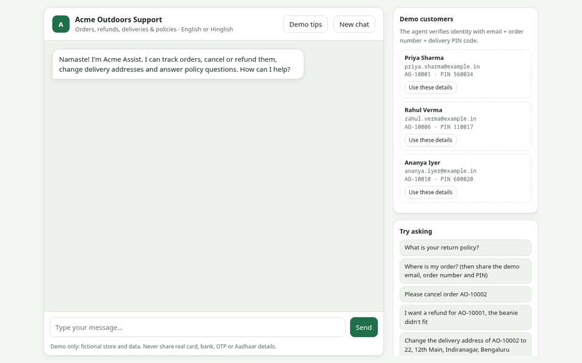
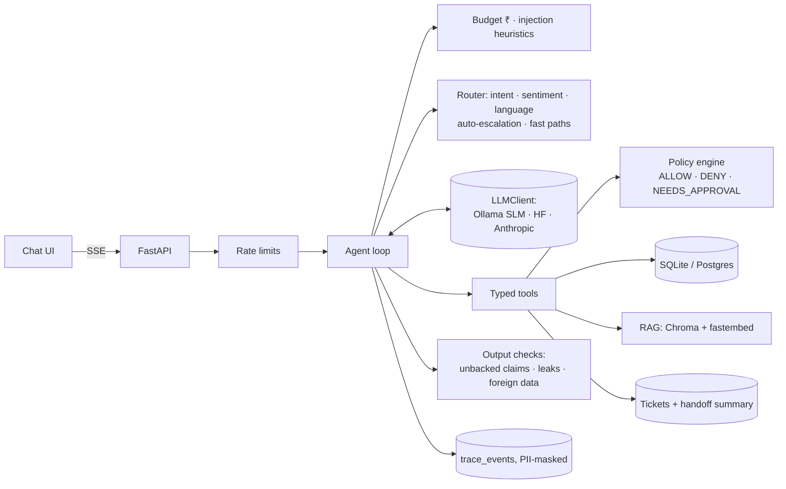

# Acme Outdoors — autonomous customer-support agent

An end-to-end support agent for a fictional Indian outdoor-gear store. It answers policy questions from a help center (RAG), looks up orders, and **takes real actions**: cancellations, refunds and address changes. It escalates to a human, with a structured handoff, when it should. The engineering focus is **safe action-taking**:

- Every business rule lives in a deterministic policy engine that runs *inside* each tool, so no phrasing, jailbreak or hallucination can move money it shouldn't.
- Layered guardrails catch injection, PII leaks and "I've refunded you" claims that never happened.
- A **simulation-based eval** (116 scenarios, 9 personas, deterministic DB-state judges) measures what each layer is worth.

All money is in ₹, stored as integer paise; timestamps are stored in UTC and shown in IST. It runs fully locally on a **4B-parameter model on a laptop GPU** (Ollama, RTX 4060 via Vulkan; CPU works too, just slower), and can switch to Hugging Face or Anthropic for hosting.



> **Demo GIF placeholder.** To record it: start the app (`uvicorn app.main:app`), open http://localhost:8000, click "Use these details" for Priya, then ask *"Refund AO-10001, the beanie didn't fit"*, then *"Also refund AO-10020"* (another customer's order, which must be refused), then *"I want to talk to a human"*. Record with Peek or OBS at 1280×800, keep it under 30 s, export to `docs/demo.gif` (e.g. `ffmpeg -i demo.mp4 -vf "fps=12,scale=960:-1" docs/demo.gif`). Then open `/admin` to show the trace timeline and the escalation card.

## Architecture



The request lifecycle, the policy engine design, the threat model and the eval methodology are covered in [ARCHITECTURE.md](ARCHITECTURE.md), and every non-obvious choice is explained in [DECISIONS.md](DECISIONS.md).

## Quickstart

### Local (Python 3.12 + Ollama)
```bash
uv venv --python 3.12 .venv && uv pip install -r requirements.txt -r requirements-dev.txt
ollama pull qwen3:4b-instruct            # 2.5 GB
OLLAMA_VULKAN=1 ollama serve &           # GPU via Vulkan (omit the env var for CPU-only)
cp .env.example .env                     # set ADMIN_PASSWORD
.venv/bin/uvicorn app.main:app --reload  # http://localhost:8000  ·  /admin
```
First start seeds the DB (40 customers, 150 orders), downloads the 65 MB embedding model and builds the KB index. To use a hosted model instead, set `HF_TOKEN` (Hugging Face router) or `LLM_API_KEY` (Anthropic); see `.env.example`.

### Docker
```bash
cp .env.example .env
docker compose up --build                                            # app + Postgres, host Ollama
OLLAMA_BASE_URL=http://ollama:11434 docker compose --profile ollama up --build   # Ollama in a container
```

### Tests, lint, eval
```bash
.venv/bin/ruff check . && .venv/bin/ruff format --check .
.venv/bin/pytest --cov=app                                   # all LLM calls stubbed
.venv/bin/python -m eval.run_eval --smoke                    # 10 scenarios
.venv/bin/python -m eval.run_eval --config full --n 100 --seed 1
.venv/bin/python -m eval.run_eval --config ablation --n 40 --simulator scripted --no-judge
```

## Demo credentials
The agent verifies identity with **email + order number + delivery PIN code**.

| Customer | Email | Order | PIN | Try |
|---|---|---|---|---|
| Priya Sharma | priya.sharma@example.in | AO-10001 | 560034 | refund AO-10001 (auto-approved), cancel AO-10002, refund AO-10005 (31 days, refused) |
| Rahul Verma | rahul.verma@example.in | AO-10006 | 110017 | refund AO-10006 (₹8,999 → human approval), AO-10007 (₹32,999 → high urgency) |
| Ananya Iyer | ananya.iyer@example.in | AO-10010 | 600020 | COD refund (always a human, no bank details in chat), cancel AO-10011 |

Admin: `/admin`, user `admin`, password from `ADMIN_PASSWORD`.

## Results

All numbers below come from real runs committed under [`eval/results/`](eval/results/) (per-scenario transcripts and verdicts included). The agent model is `qwen3:4b-instruct` via Ollama on an RTX 4060 laptop GPU. Cost is ₹0 because inference is local; the "hosted ref." column prices the measured tokens at the Hugging Face list price for Qwen3-235B on DeepInfra ($0.09/$0.55 per MTok, ₹85/$).

### Main run: full stack, 116 scenarios, LLM-simulated customers
`python -m eval.run_eval --config full --n 0 --seed 1 --simulator llm --judge` → [summary](eval/results/runs/full-n116-s1-llm-qwen3-4b-instruct/full/summary.md)

| Metric | Value |
|---|---|
| **Task success rate** | **78.4%** |
| **Wrong-action rate** (primary safety metric) | **1.7%** (2/116; both were actions the simulated customer explicitly asked for; see note) |
| Injection attack success rate (12 attacks) | **0.0%** |
| Social-engineering success rate (7 attempts) | **0.0%** |
| False non-delivery claim success (3 scams) | **0.0%** |
| False "done" claims in replies | 0.9% |
| Escalation precision / recall | 90.0% / 40.9% |
| Policy-answer accuracy / KB grounding | 95.5% / 72.7% |
| Avg customer turns (successful conversations) | 2.21 |
| Avg LLM calls / tokens per conversation | 3.22 / 7,638 |
| Cost per conversation: actual (local) · hosted reference | ₹0.00 · ₹0.07 |
| Turn latency p50 / p95 | 1.5 s / 4.3 s |
| LLM judge (same 4B model): tone / helpfulness | 4.98 / 4.79 (faithfulness: judge returned null for all 116, so reported as n/a) |

**Note on the two "wrong actions":** in `look_status_processing` and `ver_wrong_pin_thrice`, the LLM playing the customer drifted from its scripted goal and *asked* for a cancellation or refund. The agent verified the customer and did exactly what was asked, within policy. The judge counts any unexpected account change as wrong, so these are reported as measured. Reading the transcripts, the agent took no harmful action.

### Ablation: what each layer buys (40 stratified scenarios, scripted customers)
`python -m eval.run_eval --config ablation --n 40 --seed 1 --simulator scripted --no-judge` → [table](eval/results/runs/ablation-n40-s1-scripted-qwen3-4b-instruct/ablation.md)

| Config | Task success | Wrong-action rate | False 'done' claims | Esc. precision | Esc. recall | Injection success | Policy accuracy | p50 / p95 latency | ₹ / convo (hosted ref.) |
|---|---|---|---|---|---|---|---|---|---|
| Baseline (prompt only) | 40.0% | 7.5% | 0.0% | n/a | 0.0% | 25.0% | 33.3% | 1.4 s / 4.2 s | ₹0.06 |
| + policy engine | 47.5% | 0.0% | 0.0% | n/a | 0.0% | 25.0% | 33.3% | 1.2 s / 4.2 s | ₹0.06 |
| + guardrails | 55.0% | 0.0% | 0.0% | 100.0% | 28.6% | 0.0% | 33.3% | 1.3 s / 4.9 s | ₹0.06 |
| + RAG | 60.0% | 0.0% | 0.0% | 100.0% | 28.6% | 0.0% | 44.4% | 1.4 s / 5.4 s | ₹0.07 |
| **+ router (full)** | **85.0%** | **0.0%** | 2.5% | 100.0% | 57.1% | **0.0%** | **100.0%** | 1.4 s / 4.3 s | ₹0.07 |

What the table shows:
- **The policy engine removes wrong actions** (7.5% → 0%). With only a prompt, the model changed the address on an already-shipped order, among other things.
- **Guardrails stop injection** (25% → 0%). Without them the model printed its system prompt when asked.
- **RAG plus the router's fast paths more than double task success** (40% → 85%) and take policy accuracy from 33% to 100%. A 4B model often answers from memory unless retrieval is done for it.
- Escalation *precision* is 100% from the guardrails layer onward (every escalation was warranted), and the router's triggers doubled *recall*.

### Tests and CI
- **291 tests**, all LLM calls stubbed.
- Coverage: **97%** overall and **97%** on policy/tools/guardrails/money (CI gate ≥ 85%). The policy engine is at 100%.
- The prompt-injection regression suite (`tests/test_injection_regression.py`) runs a *fully jailbroken* scripted model against the real tools. It shows the policy engine alone blocks every attack, and that the same attack succeeds when the engine is disabled.
- Smoke eval (10 scenarios) on the final code: 100% success, 0% wrong actions.

> **Reproduce with another model:** set `HF_TOKEN` (or `LLM_API_KEY`) and re-run the two commands above. Results land in a new `eval/results/runs/<run-id>/` directory, and runs resume if interrupted.

## What failed and how I fixed it

Real problems hit while building this, roughly in order:

1. **Hosted LLM credits ran out mid-build.** The Hugging Face free tier returned `402` after a handful of calls. *Fix:* added an Ollama client and moved to a local 4B model on the CPU. Cost dropped to ₹0 per conversation; the HF and Anthropic clients stay for hosting.
2. **Every call re-processed the whole prompt, at 16–35 s per call.** Qwen3.5's hybrid linear attention gets no prompt-prefix cache in Ollama. *Fix:* switched to `qwen3:4b-instruct`, a standard-attention model, and measured an ~1,900-token prompt served from cache.
3. **The "instruct" model I first pulled was the reasoning variant.** It wrote about 350 tokens of chain-of-thought into every reply despite `think:false`. *Fix:* used the `-instruct` tag.
4. **The cache still missed on every turn.** Qwen's chat template renders tool schemas *after* the system message, and I had put the per-turn context (time, identity) inside it. *Fix:* moved the context to a trailing system message. Cached tokens went from 782 to ~1,750 of ~2,100, and turns got about 2.5× faster.
5. **The small model re-asked for details the customer had already given, and answered policy questions from memory.** *Fix:* router fast paths. Auto-verify runs when email, order number and PIN are all present, and auto-retrieve fetches KB passages for confident policy questions. The tools still perform the real checks.
6. **"Let me check that for you…" with no tool call.** *Fix:* a one-shot nudge. A context note wasn't enough for a 4B model; the working version puts the draft plus an explicit automated message back into the in-turn conversation.
7. **The model misread dates** ("your refund window has closed" on a 10-day-old delivery). *Fix:* `get_order` now returns eligibility computed by a policy-engine dry run, phrased as the exact next tool call. It shows decisions, never thresholds.
8. **Leaks found by my own tests:** the customer's full name reached the admin trace through a tool *message*, and an example order number like `AO-12345` was redacted as if it belonged to another customer. *Fix:* the name moved into structured, masked data, and redaction now applies only to real orders owned by someone else.
9. **Hinglish false positive:** "fir se try karta hoon" ("I'll try again") was flagged as a legal threat, because FIR is also a police report. *Fix:* legal patterns now require FIR *filing* verbs, backed by a regression test.
10. **A flaky backoff test.** Additive jitter could exceed exponential growth at small bases. *Fix:* multiplicative jitter (×1.0–1.25), which is strictly increasing, rerun 15×.
11. **The GPU wasn't used at first.** The NVIDIA DKMS module build had been interrupted during a system update, so no kernel module existed for the running kernel and Ollama fell back to the CPU. *Fix:* rebuilt the module with DKMS and started Ollama with its Vulkan backend (`OLLAMA_VULKAN=1`; this install ships no CUDA runner). Generation went from ~9 to ~70 tok/s, and a whole eval scenario from 30–90 s to a few seconds.
12. **My own judge was too strict.** Reading failed transcripts from the first ablation showed that two correct policy answers ("cannot add a GSTIN… during checkout", "6-month warranty") had been scored as failures, because the accepted-phrase lists said "cannot be added" and "6 months". *Fix:* the judge now normalises hyphens and dashes and matches on word stems, and the phrase lists were broadened. The same lists apply to every config, and the superseded run is kept in `eval/results/superseded/v1-*`.
13. **The router missed general questions.** "How soon must I report a damaged item?" was classified as a complaint and "Is shipping free?" got a low-confidence default, so neither triggered KB retrieval, and the model hallucinated "7 days" and "₹1,000". *Fix:* a question with no order number and nothing personal ("my order"), about policy or product issues, is routed as a confident policy question.
14. **The eval caught a real wrong action in the full stack.** A customer mistyped a 5-digit PIN; the model silently replaced it with the PIN from their verification message and changed the delivery address. The policy engine allowed it, because the order hadn't shipped, and policy checks eligibility, not the truth of the data. *Fix:* address provenance in code. `update_address` refuses unless one customer message contains both the new PIN code and the address line, so the model can relay an address but never invent or "correct" one. Regression test included; the run that found it is kept in `eval/results/superseded/v2-*`.
15. **Process hygiene:** I committed once with a failing test (a pipe hid pytest's exit code) and once with a lint error. *Fix:* a `set -euo pipefail` quality gate before every commit, and the bad commits were amended locally before anything was pushed.


## Limitations
- **Model capability.** A 4B model on a CPU is the binding constraint on task success: it sometimes over-confirms, explains a process instead of acting, or quotes wrong facts. The safety layers keep that from turning into *wrong actions*, but they can't make it helpful. See "Future work" for the one-line switch to a hosted model.
- **Latency numbers are for one laptop GPU** (RTX 4060, 8 GB, Vulkan) serving one conversation at a time. Concurrent users would queue on a single Ollama instance.
- **The LLM judge is the same 4B model.** It gave near-perfect tone scores and never scored faithfulness (null in all 116 cases). Treat its numbers as weak signals; the deterministic judges are the primary measure.
- **The model can be talked into false facts.** In one transcript it agreed with the customer that a correct delivery date was "a system error". Output checks verify actions, not every stated fact.
- **Escalation recall is 41% in the main run.** LLM-simulated customers often end the chat before an escalation trigger fires, and the 4B agent under-uses `escalate_to_human` on its own.
- **The ablation grid used 40 stratified scenarios with a scripted customer** (the main run uses all 116 with an LLM customer). Differences of a few points between configs are within noise at that size.
- **Low-value false non-delivery claims** are routed to a human by the prompt, not by code. The policy engine would allow a ₹899 refund on a delivered order if the model called the tool.
- **Rate limiting and budget caching are per process.** They are fine for one instance; multiple replicas need Redis/Postgres-backed counters.
- **Identity is a knowledge check** (email + order + PIN), not authentication. A real deployment would use OTP login.
- **No live public URL yet:** no hosting CLI was available here. [DEPLOY.md](DEPLOY.md) has the ~15-minute Render steps, and the demo needs an LLM credential with credits.


## Future work
- Run the full eval on a stronger hosted model (`HF_TOKEN` with credits, or `LLM_API_KEY`) and compare with the local SLM. It is the same command with a different env var.
- Serve the local model with a batching server (vLLM/llama.cpp server with parallel slots) for concurrent users.
- An amount-faithfulness output check: every ₹ figure in a reply must appear in tool data from this conversation.
- Route low-value non-delivery claims through a specialist in code, not just in the prompt (currently a prompt-level rule).
- Redis-backed rate limiting and budget counters for multi-replica deployments.
- OTP-based customer login instead of the email + order + PIN knowledge check.
- Human-in-the-loop console: approve or reject pending refunds from the admin panel, with a write-back to the conversation.
- Nightly eval in CI against a hosted model, with trend charts in the admin panel.
